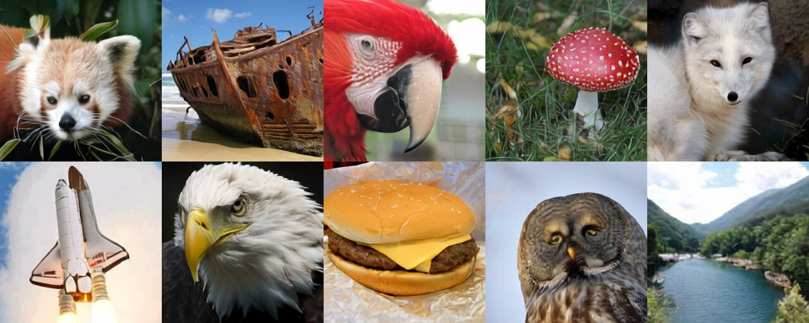
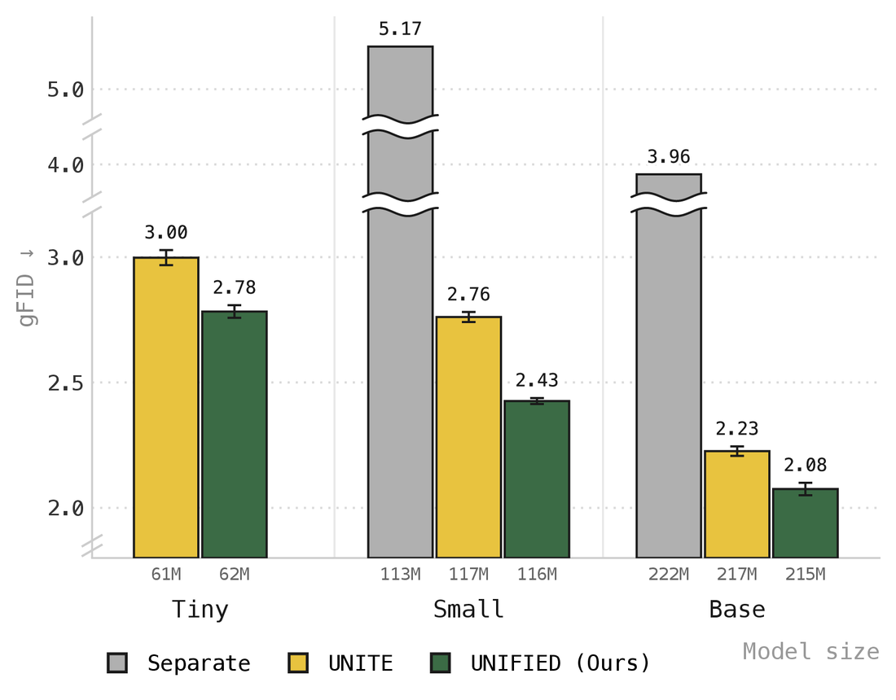
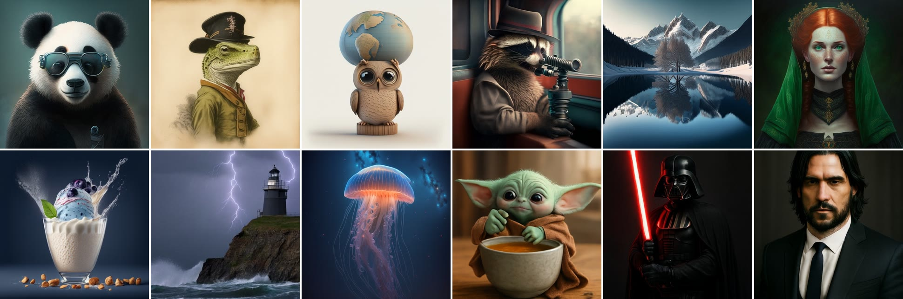

<h1 align="center">UNIFIED: Single-Transformer Latent Diffusion</h1>

<p align="center">
  <a href="https://haoyuhsu.github.io/Unified-LDM/"></a>
  
  
</p>

<p align="center"><b>Three networks. One transformer.</b></p>

<p align="center">
  <a href="https://haoyuhsu.github.io/">Hao-Yu Hsu</a>,
  <a href="https://shenlong.web.illinois.edu/">Shenlong Wang</a>,
  <a href="https://www.alexander-schwing.de/">Alexander G. Schwing</a><br>
  University of Illinois Urbana-Champaign
</p>

<p align="center"><i><b>UNIFIED</b> encodes, generates, and decodes images with one diffusion transformer.<br>Every backbone weight is shared, and the model trains in a single stage, without DINO or GAN supervision.</i></p>

<p align="center">
  <a href="https://haoyuhsu.github.io/Unified-LDM/"></a>
</p>
<p align="center"><sub>Class-conditional samples from UNIFIED-B (215M), ImageNet-1K 256×256.</sub></p>


## 💡 Idea

UNIFIED casts encoding, generation, and decoding as position-aligned sequence maps over one fully shared diffusion transformer, distinguished only by a mode token and the timestep.

<p align="center">
  
</p>
<p align="center"><sub>Encoder, generator, decoder. Now one set of weights.</sub></p>

**Key takeaway:**
- **The decoder need not be a separate network.** One diffusion transformer can encode, generate, and decode with every backbone weight shared, and it improves generation over UNITE at about 60M, 115M, and 215M parameters.
- **Decoder parameters are better spent in the shared backbone.** At a fixed Tiny budget, moving UNITE's parameters from the decoder to the generative encoder improves gFID from 5.01 to 3.00, and removing the standalone decoder improves it further, to 2.78.
- **How the three modes are specified matters as much as sharing the weights.** Position alignment restores reconstruction, encoding at *t* = 1 matches what the encoder reads, and a learned decoding timestep removes the conflict between decoding and generation at the clean endpoint.

## 📊 Results

### Class-conditional ImageNet-1K 256×256

With the same parameter budget and training recipe, UNIFIED outperforms both the separate-network pipeline (encoder, generator, and decoder trained as three networks) and UNITE (shared encoder and generator with a standalone decoder) at every model size.

<p align="center">
  
</p>
<p align="center"><sub>gFID ↓ at three model sizes; bar labels give the total trainable parameters.</sub></p>

Against published models under 250M parameters, UNIFIED-S outperforms every pixel-space model of similar size, and UNIFIED-B has the lowest gFID of any model under 250M parameters, without auxiliary DINO features.

| Size     | Method            | Networks        | No aux. info. | Diffuses in    | Params | gFID ↓   | IS ↑      |
|----------|-------------------|-----------------|:-------------:|----------------|-------:|---------:|----------:|
| ≤100M    | UNITE-T\*         | Gen. + Dec.     | ✓             | Dynamic latent |    61M |     3.00 |     272.4 |
|          | **UNIFIED-T**     | Gen.            | ✓             | Dynamic latent |    62M | **2.78** | **280.1** |
| 100–150M | JiT-B/16          | Gen.            | ✓             | Pixels         |   131M |     3.66 |     275.1 |
|          | PixelREPA-B/16    | Gen. + VFM      | ✕             | Pixels         |   131M |     3.17 |     284.6 |
|          | JiT-B/16 + RG     | Gen.            | ✓             | Pixels         |   131M |     2.96 |     251.1 |
|          | UNITE-S\*         | Gen. + Dec.     | ✓             | Dynamic latent |   117M |     2.76 |     283.9 |
|          | **UNIFIED-S**     | Gen.            | ✓             | Dynamic latent |   116M | **2.43** | **295.9** |
| 150–250M | PixelU-B/16       | Gen. + VFM      | ✕             | Pixels         |   164M |     3.40 |     276.0 |
|          | DSD               | Gen. + VFM      | ✕             | Dynamic latent |   205M |     3.35 |     255.0 |
|          | REPA-B, two-stage | Gen. + AE + VFM | ✕             | Frozen latent  |   214M |     2.15 |     268.3 |
|          | UNITE-B\*         | Gen. + Dec.     | ✓             | Dynamic latent |   217M |     2.23 |     282.1 |
|          | **UNIFIED-B**     | Gen.            | ✓             | Dynamic latent |   215M | **2.08** | **314.4** |

<sub>\* UNITE trained under our protocol. AE: pretrained autoencoder. VFM: pretrained vision foundation model (DINO). No aux. info.: ✓ if training uses no auxiliary pretrained representation, such as DINO features. Dynamic latent: a latent learned jointly with the generator.</sub>

### Text-to-image

The same recipe extends to text: swap the class embedding for a text encoder and train from scratch, with no pretrained VAE. At 512×512, UNIFIED-B reaches a **GenEval score of 0.87 with only 218M parameters**, above models with 1.1B–1.2B parameters such as DeCo-XXL/16 (0.86).

<p align="center">
  
</p>
<p align="center"><sub>UNIFIED-B (218M) at 512×512, 50 Euler steps, guidance scale 6.0.</sub></p>

See the [project page](https://haoyuhsu.github.io/Unified-LDM/) for the design path, compute budgets, and full text-to-image benchmarks.

## 📦 Release

The code is coming soon. Stay tuned!

## 📖 Citation

If you find this work useful, please consider citing:

```bibtex
@article{hsu2026unified,
  title   = {Single-Transformer Latent Diffusion},
  author  = {Hsu, Hao-Yu and Wang, Shenlong and Schwing, Alexander G},
  journal = {Under review},
  year    = {2026}
}
```
